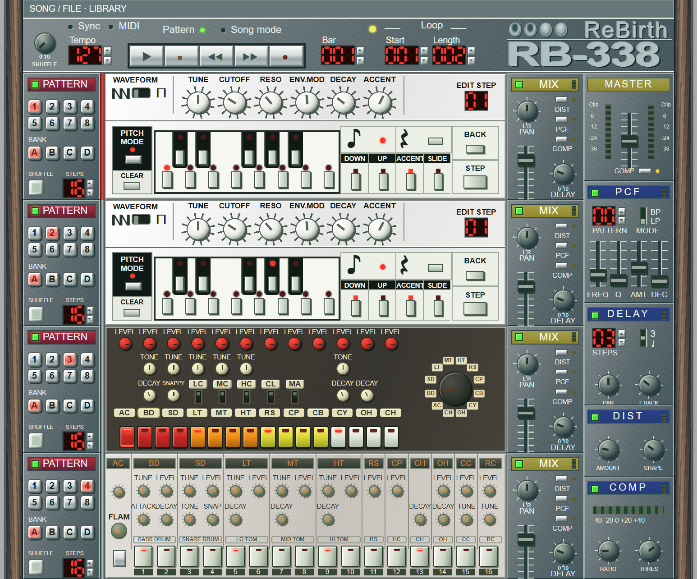

# RB-338 Craft

A Rust music workstation with the ReBirth RB-338 rack: two 303-style bass synthesizers, 808-style and 909-style drum machines, pattern sequencing, and effects. This repository contains a browser version and a separate native Windows application.

The Windows version runs directly as an executable with native rendering, audio, MIDI, and file access. The browser version runs the Rust engine as WebAssembly inside an AudioWorklet, with small JavaScript adapters for browser audio and MIDI APIs. All sound is synthesized at runtime without recorded samples or waveform ROMs.



*Screenshot of the web version. Native visual matching has not been verified.*

## Windows native version

Download the Windows x64 ZIP from the [v0.1.0 release](https://github.com/IvRogoz/rb-338-Craft/releases/tag/v0.1.0), extract it, and open `RB-338-Craft.exe`. It requires no browser, WebView, WebAssembly, Node.js, or local server. Windows graphics and audio drivers and the Microsoft Visual C++ x64 runtime are required; see the [native requirements](native/README.md#download-and-run).

The native app uses the web rack's design coordinates and native Rust drawing for its controls. It supports JSON and RBS import, JSON saving, a named song library in `%LOCALAPPDATA%\RB338Craft\Songs`, WAV loop export, and native MIDI input. See the [native README](native/README.md) for controls, requirements, and verification limits.

To build from source:

```powershell
cd native
.\build.ps1
```

The output is `native/target/release/rb338-native.exe` relative to the repository root. The native folder is its own Rust workspace; build and test it from that folder.

Native-window appearance, interactive controls, file dialogs, and physical MIDI input remain unverified. The executable has passed its muted audio/file checks and non-window drawing checks; those checks do not establish visual parity with the web version.

## Features

- Two bass synths with saw/square oscillators, resonant filters, envelopes, accents, and tied slides.
- Synthesized 808-style and 909-style percussion, including shared 808 voice switches and 909 accents and flams.
- 32 patterns per section, independent pattern lengths and shuffle, and pattern copy, paste, randomize, and clear tools.
- Song arrangements, loop ranges, measure editing, and automation recording.
- Section mixers with level, pan, mute, delay sends, and insert routing.
- Distortion, a pattern-controlled filter (PCF), compression, and tempo-synchronized delay.
- Named song saves, JSON import/export, and original ReBirth `.rbs` import.
- Stereo WAV loop export and MIDI input with optional clock/transport sync.

Both versions use a proportionally scaled rack and a top **SONG / FILE · LIBRARY** modal for song files, arrangements, MIDI, and supplementary controls. The web interface uses HTML/CSS; the native interface uses Rust drawing.

## Web version: build and run locally

### Requirements

- A native Rust toolchain with `cargo` and `rustup` on your path.
- PowerShell on Windows, or a POSIX shell on macOS/Linux.
- A browser supporting WebAssembly, Web Audio, and AudioWorklet.
- Internet access for the initial tool and dependency downloads.

Run these commands from the repository root.

**Windows (PowerShell)**

```powershell
.\build.ps1
cargo run --release -p rb-devserver
```

**macOS / Linux**

```sh
sh build.sh
cargo run --release -p rb-devserver
```

Open [http://127.0.0.1:3380](http://127.0.0.1:3380) and press Play to initialize audio and start playback. Stop the server with `Ctrl+C`.

The build scripts add Rust's `wasm32-unknown-unknown` target, install `wasm-bindgen-cli` version `0.2.130` into the project-local `tools/` directory when absent, and generate the app in `dist/`. The application uses a native Rust build pipeline with no Node.js runtime, JavaScript package manager, or bundler.

The server binds only to `127.0.0.1`, serves `dist/`, and does not open a browser automatically. Once built, the app needs no external service. To change the port:

```sh
cargo run --release -p rb-devserver -- 3381
```

Then open [http://127.0.0.1:3381](http://127.0.0.1:3381).

## Using the rack

1. **Choose patterns.** Select a bank, then a pattern number in each section's left-hand pattern selector.
2. **Program synths.** Use the pitch buttons and note/pause, octave, accent, slide, back, and step controls. Pitch Mode advances after pitch entry.
3. **Program drums.** Select an instrument and edit its steps. The 808 shared-voice switches choose tom/conga, rim/claves, and clap/maracas; the 909 also supports accented hits and flams.
4. **Shape the mix.** Adjust section level, pan, and delay send. Insert processing runs distortion → PCF → compression. PCF and compression each select one destination; compression can also process the master.
5. **Arrange a song.** Open **SONG / FILE · LIBRARY** at the top to add scenes and edit measures. Set **Start** and **Length** in the transport and enable **Song mode** to play the arrangement.

Press **Space** to toggle playback. The keys `A W S E D F T G Y H U J` enter chromatic pitches for the selected synth. These shortcuts are disabled while the song modal is open or focus is in an input field or selector.

Delay follows the tempo with straight sixteenths or eighth-note triplets. Stop ends sequencing while retaining echo tails; a second Stop clears the previous tail while repositioning.

### Web Song / File modal

Open the top **SONG / FILE · LIBRARY** button. Close the modal with **CLOSE** or **Escape**.

| Control | Purpose |
| --- | --- |
| **SAVE / LOAD / DELETE** | Manage named songs in the current browser's local storage. |
| **DOWNLOAD JSON** | Download a portable song file. |
| **IMPORT** | Load a JSON song or an original ReBirth `.rbs` file. |
| **EXPORT LOOP WAV** | Render the selected arrangement loop as stereo, 16-bit PCM at 44.1 kHz. |
| **ENABLE MIDI** | Request browser MIDI access and select inputs and channel. |
| **MIDI SYNC** | Follow incoming MIDI clock and transport messages. |

The modal also contains pattern and measure utilities, scene selection, Vintage, Metronome, and Delay Wet controls.

Browser saves belong to the browser and origin, including the port. Download JSON files for portable backups. Legacy `rb338:` saves are supported. Example `.rbs` files are in [`songs/rbs-examples/`](songs/rbs-examples/); see the [example song notes](songs/rbs-examples/README.md).

WAV export renders exactly the selected loop and does not append delay tails. Include extra bars when needed. Exports are limited to 256 MiB.

MIDI requires browser Web MIDI support and device permission. Choose a device or **ALL INPUTS**, then select a channel. Notes, mapped controller messages, and optional clock/transport synchronization are supported.

## Development and checks

Run the web workspace tests from the repository root:

```sh
cargo test --workspace
```

Run native checks from its independent workspace:

```powershell
cd native
cargo test --workspace
cargo run --release -- --self-test
```

The native self-test keeps audio output muted and creates no window. It checks audio buffers, transport, recording acknowledgements, JSON round trips, RBS import, WAV export, and drawing-mesh validity. A working Windows audio output device is required even with output muted. Reports are written under `native/target/self-test/` when run from `native/`.

Render 12 seconds of the default song through the native audio engine:

```sh
cargo run --release -p rb-engine --example render -- default target/verification/mix.wav 12
```

The renderer accepts a song path (`.rbs` or JSON), output WAV path, duration in seconds, and an optional isolated drum ID (`kit * 16 + instrument row`). Its output is stereo, 16-bit PCM at 48 kHz, with peak, RMS, and clipping reports. Generated WAVs are outputs, never synthesis sources.

For silent browser checks, use [http://127.0.0.1:3380/?muted=1](http://127.0.0.1:3380/?muted=1). The engine and meters continue running through a zero-gain output node.

Tests cover import validation, patterns and transport, arrangements and automation, synthesis behavior, effects, MIDI decoding, and WAV export. Passing tests do not establish perceptual equivalence to the original ReBirth application.

## Project structure

| Path | Contents |
| --- | --- |
| [`crates/model/`](crates/model/) | Typed song data, validation, arrangements, legacy JSON conversion, and RBS import. |
| [`crates/engine/`](crates/engine/) | Synths, percussion, sequencing, effects, and the worklet ABI. |
| [`crates/web/`](crates/web/) | Rust browser interface, WAV export, MIDI decoding, browser adapters, and CSS rack. |
| [`crates/devserver/`](crates/devserver/) | Native loopback-only static file server. |
| [`songs/rbs-examples/`](songs/rbs-examples/) | Original ReBirth example songs used by importer tests. |
| [`native/`](native/) | Independent Windows Rust workspace, native interface and device adapters, copied engine/model, and build instructions. |
| `dist/` | Generated browser application. |
| `tools/` | Project-local build tools. |

## Sound fidelity and credits

This is a Rust reimplementation, not the original ReBirth audio engine. Exact ReBirth timbre matching has not been established. The 909 metallic voices are synthesized replacements for the original sample-based sounds. The runtime uses digital oscillators, envelopes, noise, and filters rather than electrical component-network simulation.

Synthesis references, source credits, and retained license notices are in [THIRD_PARTY_NOTICES.md](THIRD_PARTY_NOTICES.md). The original interface artwork described there is retained only as local reference material; the web interface uses HTML/CSS and the native version draws its interface in Rust.
